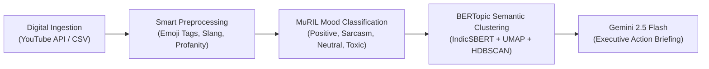

# IndicPulse 🇮🇳
### Cross-Platform Indian Semantic & Sentiment Analyzer

[](https://www.python.org/downloads/)
[](https://streamlit.io)
[](https://huggingface.co/google/muril-base-cased)
[](https://huggingface.co/l3cube-pune/indic-sentence-bert-nli)
[](https://ai.google.dev/)
[](LICENSE)

> **IndicPulse** is a platform-agnostic AI analytics engine designed for the nuances of Indian social media. It ingests comments from digital platforms (YouTube, Instagram, Reddit, CSV reviews), decodes Romanized code-mixed languages (**Hinglish**), tags emojis, catches sarcasm and trolling, isolates toxic abuse into quarantine, and produces engagement-weighted executive summaries powered by **Gemini 2.5 Flash** in a modern **Soft Pastel Bento-Grid SaaS Studio**.

---

## 🎨 Soft Pastel Bento-Grid UI & Distinct Color Palette

The interface is engineered around a clean, distraction-free **SaaS Bento-Grid layout** with high-contrast accessibility and **Okabe-Ito colorblind-safe** validation:

| Sentiment / Mood | Default Pastel Hex | Okabe-Ito (Colorblind-Safe) | Semantic Meaning |
| :--- | :--- | :--- | :--- |
| **Positive (Aggressive Hype)** | `#10B981` (Mint Emerald) | `#0072B2` (Deep Blue) | Genuine audience praise, product appreciation, excitement |
| **Sarcastic / Trolling** | `#8B5CF6` (Soft Lavender) | `#E69F00` (Warm Orange) | Irony, humor, meme references, playful mockery |
| **Neutral / Informational** | `#94A3B8` (Cool Slate Gray) | `#94A3B8` (Slate Gray) | Questions, factual comments, timestamps, neutral remarks |
| **Toxic / Abusive** | `#F43F5E` (Blush Rose Red) | `#D55E00` (Vermilion) | Hostile abuse, hate speech, vulgarity (auto-quarantined) |

---

## 🚀 Quick Start

### 1. Clone the Repository
```bash
git clone https://github.com/Divanshu23438/sentiment_analysis.git
cd sentiment_analysis
```

### 2. Install Dependencies
```bash
pip install -r requirements.txt
```

### 3. Configure API Credentials (Optional for Demo Mode)
Create a `.env` file from `.env.example`:
```bash
cp indicpulse/.env.example .env
```
Fill in your API keys (or test with the built-in demo dataset without keys):
```ini
YOUTUBE_API_KEY=AIzaSy...
GEMINI_API_KEY=AIzaSy...
```

### 4. Launch IndicPulse Studio
```bash
python run.py
```
*Alternatively:*
```bash
cd indicpulse
streamlit run app.py
```
Open [http://localhost:8501](http://localhost:8501) in your browser.

---

## 🏗️ Project Architecture

```
sentiment_analysis/
├── run.py                          ← One-click launcher script
├── requirements.txt                ← Python package manifest
├── README.md                       ← Project documentation
├── .gitignore                      ← Secret & artifact protection
└── indicpulse/
    ├── app.py                      ← Streamlit 6-Page Bento Studio frontend
    ├── pipeline.py                 ← Master orchestrator facade (scaled for 2,000+ comments)
    ├── .env.example                ← Template for API keys
    ├── core/
    │   ├── ingestion.py            ← Step 1: Paginated YouTube Data API v3 & CSV Parser
    │   ├── preprocessor.py         ← Step 2: Emoji-to-tag transliteration & Hinglish slang normalizer
    │   ├── mood_classifier.py      ← Step 3: MuRIL 4-class classifier with hardware acceleration
    │   ├── topic_clusterer.py      ← Step 4: IndicSBERT + BERTopic (UMAP & HDBSCAN)
    │   └── summarizer.py           ← Step 5: Gemini 2.5 Flash executive action summarizer
    ├── ui/
    │   ├── styles.py               ← Pastel Bento CSS with High-Contrast & Dyslexia modes
    │   └── charts.py               ← Plotly ring donut, engagement bars, timeline & pulse gauges
    ├── data/
    │   ├── sample_reviews.csv      ← Curated Hinglish demo review dataset
    │   └── training_labels.csv     ← Labeled training dataset for MuRIL fine-tuning
    ├── models/                     ← Local fine-tuned model checkpoint directory
    └── notebooks/
        ├── 01_finetune_muril_colab.ipynb   ← Google Colab T4 GPU fine-tuning notebook
        └── 02_explore_pipeline.ipynb       ← Interactive pipeline exploration notebook
```

---

## 🧠 The 5-Step Pipeline



1. **Digital Ingestion (Step 1):** Paginated extraction supporting up to 2,000 comments via YouTube Data API v3 (`relevance` / `time` order) or universal CSV upload.
2. **Hinglish Preprocessor (Step 2):** Converts emojis into contextual tags (`🔥` → `[fire_hype]`, `🤡` → `[clown_mocking]`), normalizes character elongations (`sooooo good` → `so good`), and de-obfuscates masked profanities.
3. **MuRIL Classifier (Step 3):** Powered by Google's `muril-base-cased` with RAM singleton caching and automatic device placement (`cuda:0`, `mps`, or `cpu`) with `batch_size=32`.
4. **Semantic Clustering (Step 4):** Uses `l3cube-pune/indic-sentence-bert-nli` (IndicSBERT) and adaptive BERTopic with dynamic min-cluster sizing.
5. **Executive Summarizer (Step 5):** Leverages `gemini-2.5-flash` with log-scaled engagement weights ($W = \log_{10}(\text{Likes} + 1) + 1$) to deliver actionable creator insights.

---

## ♿ Accessibility & Universal Design

- **High-Contrast Mode:** 2px high-contrast borders and WCAG AAA compliant text contrast ratios.
- **Colorblind-Safe Mode:** Okabe-Ito colorblind palette scientifically validated for Protanopia, Deuteranopia, and Tritanopia.
- **Dyslexia Font Support:** High-legibility font switching with expanded letter and line spacing.
- **Reduced Motion:** Disables all CSS hover transitions and animations for motion sensitivity.

---

## 📄 License
This project is licensed under the MIT License - see the LICENSE file for details.
